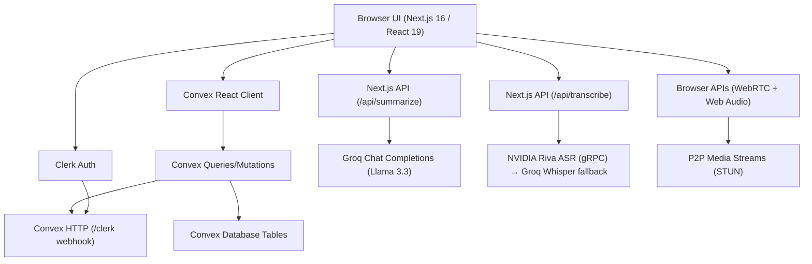

# Meetup — AI meeting workspace

**Live:** [meetup.tanmaymirgal.dev](https://meetup.tanmaymirgal.dev)

[](https://nextjs.org/)
[](https://react.dev/)
[](https://convex.dev/)
[](https://clerk.com/)
[](https://tailwindcss.com/)

**Meetup** is a real-time, collaborative video meeting platform featuring live transcription (Hindi, Marathi and English), AI-generated meeting summaries, action item extraction and automated task tracking. Built with React 19, Next.js 16, Convex, Clerk, WebRTC, NVIDIA Riva speech recognition and Groq inference.

---

## ✨ Features

- **🔒 Organization-Scoped Multi-Tenancy**: Built-in tenant isolation and organization switching powered by Clerk.
- **📹 Real-Time WebRTC Video Rooms**: Peer-to-peer audio, video, and screen sharing using Google's STUN signaling protocol managed dynamically through Convex tables.
- **💬 Reactive Chat & Room Presence**: Real-time message exchanges and live status tracking (mic, camera, screensharing, heartbeat) for all room participants.
- **✍️ Multilingual Live Transcription**: Real-time microphone audio is transcribed by NVIDIA Parakeet (Riva ASR) with Groq Whisper (`whisper-large-v3`) as the fallback. Supports `Auto`, `English`, `Hindi`, `Marathi` and mixed Hindi/English/Marathi modes. See [Transcription providers](#-transcription-providers).
- **🤖 Intelligent Meeting Summaries**: Automated AI summarization via Groq Llama 3.3 (`llama-3.3-70b-versatile`) that outputs detailed summaries, key points, and core decisions.
- **✅ Automagic Action Items & Tasks**: Action items generated from meetings are automatically extracted and converted into interactive, trackable organization tasks.
- **🎨 Meetup Design System**: A violet-on-ink dark theme with Manrope headings and Inter body text, built on Tailwind CSS v4, Radix UI and shadcn/ui. Brand tokens live in `app/globals.css`; the logo is in `components/brand/logo.tsx`.
- **📈 Workspace Insights**: Real-time analytics dashboards presenting organizational productivity metrics, meeting frequency, and timeline views via Recharts.
- **📓 Collaborative Whiteboarding**: Embedded whiteboards powered by Excalidraw for real-time visual collaboration.

---

## 🏗️ High-Level Architecture

The project utilizes a highly reactive serverless architecture. Frontend components subscribe directly to Convex databases, creating an instantly updating UI experience without manual polling or refetching.



---

## 📁 File Structure

```text
meetup/
├── app/                        # Next.js App Router root
│   ├── (auth)/                 # Clerk Auth routes (Sign-in/up)
│   ├── (dashboard)/            # Dashboard, meetings, tasks, settings
│   ├── (meeting-room)/         # Active video meeting room & controls
│   ├── (onboarding)/           # User and Org setup onboarding flow
│   ├── api/                    # API endpoints for AI summarization/transcription
│   └── providers/              # Global state & service providers
├── components/                 # Reusable React & UI primitives
│   ├── ui/                     # Radix & shadcn/ui base primitives
│   ├── dashboard/              # Widgets, metrics, and chart views
│   └── home/                   # Marketing and landing page components
├── features/                   # Core business domain logic
│   ├── ai/                     # Transcription hook, modes & insights
│   ├── meeting/                # Meeting models, dialogs, forms, views
│   ├── tasks/                  # Tasks management views & logic
│   └── webrtc/                 # WebRTC hooks, track managers, participant grids
├── convex/                     # Backend serverless database & logic
│   ├── schema.ts               # Core database schemas
│   ├── users.ts / meetings.ts  # Database operations & validation
│   └── http.ts                 # Clerk webhooks mirror endpoints
├── hooks/                      # Global helper hooks (mobile detection, etc.)
└── lib/                        # Site config, SEO metadata, plans, transcription providers
```

---

## ⚙️ Getting Started

### Prerequisites
Make sure you have [Node.js](https://nodejs.org/) installed on your machine.

### 1. Clone the Repository
```bash
git clone https://github.com/Tanmay-Mirgal/Smart-Meeter.git
cd Smart-Meeter
```

### 2. Install Dependencies
```bash
npm install
```

### 3. Set Up Environment Variables
Copy [`.env.example`](.env.example) to `.env.local` and fill in the values. At minimum you need Clerk, Convex and one transcription provider:

```env
NEXT_PUBLIC_CLERK_PUBLISHABLE_KEY=
CLERK_SECRET_KEY=
CLERK_WEBHOOK_SECRET=
NEXT_PUBLIC_CONVEX_URL=

# Transcription (either or both)
NVIDIA_API_KEY=            # https://build.nvidia.com
GROQ_API_KEY=              # Whisper fallback + AI summaries
TRANSCRIPTION_PROVIDER=auto

# Production only — canonical URL for SEO, sitemap and invite links
NEXT_PUBLIC_APP_URL=https://meetup.tanmaymirgal.dev
```

When `NEXT_PUBLIC_APP_URL` is unset the app uses `http://localhost:3000` in development and `https://meetup.tanmaymirgal.dev` in production.

### 4. Start the Convex Backend
In a separate terminal, launch the Convex development server. This compiles and deploys your schema, functions, and listens for changes:
```bash
npx convex dev
```

### 5. Run the Frontend Development Server
In your main terminal, start the Next.js development server:
```bash
npm run dev
```

Open [http://localhost:3000](http://localhost:3000) in your browser to view the application.

---

## 🎙️ Transcription providers

`/api/transcribe` routes every audio chunk through `lib/transcription`:

| `TRANSCRIPTION_PROVIDER` | Behaviour |
| --- | --- |
| `auto` (default) | NVIDIA Parakeet for English / Hindi / Hindi+English, Groq Whisper for Marathi modes. Falls back to whichever provider is configured. |
| `nvidia` | NVIDIA first for every mode (Marathi uses language `multi`), Groq as the fallback. |
| `groq` | Groq Whisper only. |

- NVIDIA is called over gRPC (`grpc.nvcf.nvidia.com:443`) with `NVIDIA_API_KEY`; the channel is reused between chunks. A self-hosted Speech NIM works via `NVIDIA_ASR_HTTP_URL` or `NVIDIA_ASR_SERVER`.
- Parakeet multilingual supports Hindi and English but not Marathi, which is why Marathi modes prefer Whisper in `auto`.
- The browser downsamples audio to 16 kHz before upload, which cuts each request to about a third of its size.

---

## 🛠️ Build and Linting

- **Run Linter**: `npm run lint`
- **Type check**: `npm run typecheck`
- **Run tests**: `npm test` (unit tests, Convex function tests and the ecosystem-connector conformance suite)
- **Build Production App**: `npm run build`
- **Start Production Server**: `npm run start`

---

## 🔌 Ecosystem connector

Meetup can be connected to a central "Hub" (CP1 — Ecosystem Connector Protocol v1): schedule and end meetings, read transcripts, summaries, decisions and tasks, create tasks, and receive signed `meeting.summary.ready` webhooks. It is **off by default** (`CONNECTOR_ENABLED`) and changes nothing when off. See [`docs/CONNECTOR.md`](docs/CONNECTOR.md) for the API, the event catalog, security model and the production runbook, and `npm run connector:smoke` to check a running deployment.

---

## 🔮 Future Enhancements & Roadmap
- [ ] **STUN/TURN Integration**: Implementing full TURN servers to support peer-to-peer connections behind strict corporate firewalls.
- [ ] **Advanced Meeting Analytics**: Sentiment timelines, talk-time stats per participant, and historical org-wide meeting logs.
- [ ] **Recording Persistence**: Storing full WebRTC recording video chunks inside Convex File Storage or AWS S3 for post-meeting playbacks.
- [ ] **Stripe Monetization**: Integrating paid billing tiers for higher usage limits (e.g., transcripts quota or custom integrations).
